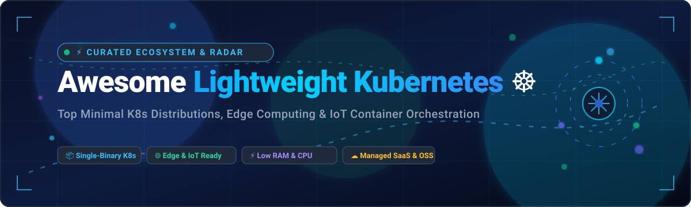

# Awesome-Lightweight-Kubernetes ☸️

<div align="center">



<br/>

<a href="https://github.com/ishandutta2007/Awesome-Awesome-Awesome"></a><a href="https://discord.gg/jc4xtF58Ve"></a>
[](https://opensource.org/licenses/MIT)
[](https://github.com/ishandutta2007/Awesome-Lightweight-Kubernetes/pulls)
[](https://kubernetes.io)
[](https://github.com/ishandutta2007/Awesome-Lightweight-Kubernetes)
<a href="https://github.com/ishandutta2007"></a>

<p align="center">
  <b>A curated list of delightfully lightweight Kubernetes distributions, edge computing orchestration frameworks, low-resource embedded clusters, and managed SaaS K8s platforms.</b>
</p>

<sub>Last updated: March 2026 • Curated for DevOps, Platform Engineers, SREs, IoT Developers, and Edge Architects</sub>

</div>

---

## 📑 Table of Contents

- [🌐 Sector Overview & Market Dynamics](#-sector-overview--market-dynamics)
- [☁️ SaaS & Hosted Kubernetes Platforms](#️-saas--hosted-kubernetes-platforms)
- [🛠️ Open-Source Kubernetes Projects & Tools](#️-open-source-kubernetes-projects--tools)
- [🏗️ Recommended Architectural Stacks](#️-recommended-architectural-stacks)
- [🤝 How to Contribute](#-how-to-contribute)
- [💖 Support & Sponsorship](#-support--sponsorship)
- [📈 Star History](#-star-history)
- [⚠️ Disclaimer](#️-disclaimer)

---

## 🌐 Sector Overview & Market Dynamics

The global **Kubernetes Solutions & Container Orchestration Market** is estimated at **$3.8 billion to $4.5 billion**, rapidly expanding toward **$9.5+ billion** (CAGR ~21–24%) driven by edge computing, AI inference workloads, and IoT deployments.

The sector exhibits **moderate concentration with a bifurcated dynamic**: the cloud-hosted control plane space is dominated by hyperscalers (Microsoft Azure, Amazon AWS, Alphabet Google), while the lightweight edge, on-premise, and single-binary Kubernetes niche remains **healthy and moderately fragmented**—powered by strong open-source communities, specialized managed vendors (SUSE Rancher, Civo, Mirantis, Platform9), and modular CNCF edge orchestrators.

---

## ☁️ SaaS & Hosted Kubernetes Platforms

Hosted and managed Kubernetes offerings sorted descending by company size (valuation / annual revenue).

| Platform / Vendor 🏢 | Company Scale (Rev / Val) 📊 | Starting Tier Pricing 💵 | Free Tier Limits / Trial 🎁 | Core Lightweight & Edge Capabilities ⚡ |
| :--- | :--- | :--- | :--- | :--- |
| **[Google GKE](https://cloud.google.com/kubernetes-engine)** | ~$350B+ (Alphabet / Google Cloud) | $0.10/cluster/hr (~$73/mo) for Standard cluster management fee | **Free forever**: $74.40 monthly billing credit per billing account covers 1 zonal/Autopilot cluster control plane; free $300 credits on 90-day trial | Autopilot automated scaling & pod provisioning; minimal control-plane overhead, multi-zone reliability. |
| **[Azure AKS](https://azure.microsoft.com/en-us/products/kubernetes-service)** | ~$245B+ (Microsoft Cloud) | $0.00/hr (Cluster management is free; pay only for underlying VM worker nodes starting ~$0.02/hr) | **Free forever**: Free cluster management plane forever for unlimited standard clusters; $200 credits for 30-day initial trial | Free control plane; Azure IoT Edge integration, Azure AD/RBAC, Virtual Nodes powered by Virtual Kubelet. |
| **[AWS EKS](https://aws.amazon.com/eks/)** | ~$110B+ (Amazon Web Services) | $0.10/hr per cluster (~$73/month flat control plane fee) + worker compute | **Free trial**: 12-month AWS Free Tier includes 750 hrs/mo micro EC2 instances (EKS control plane fee still applies; $300 AWS promotional credits for new accounts) | EKS Anywhere for bare-metal on-prem, AWS Fargate serverless containers with zero worker node management. |
| **[VMware Tanzu](https://tanzu.vmware.com/)** | ~$61B+ (Broadcom) | $150/core/year (Tanzu Standard / Foundation enterprise licensing) | **Free trial**: 60-day fully functional evaluation license of VMware Tanzu Kubernetes Grid | Enterprise vSphere virtualization integration, edge telco deployments, fleet-wide governance. |
| **[Red Hat OpenShift](https://www.redhat.com/en/technologies/cloud-computing/openshift)** | ~$3.8B+ (IBM Red Hat) | $0.076/hour per 4 vCPU cluster unit (~$55/month) on cloud marketplaces (ROSA/ARO) | **Free trial**: 60-day self-managed evaluation trial; Red Hat Developer Sandbox provides 30-day renewed free 4-pod access | Single Node OpenShift (SNO) designed for small footprints and remote edge architectures; full GitOps pipeline. |
| **[Rancher Prime](https://www.rancher.com/)** | ~$650M+ (SUSE) | $1,200/node/year (Rancher Prime commercial enterprise subscription) | **Free forever**: Core SUSE Rancher and k3s are 100% free open-source software; Rancher Prime offers 90-day evaluation trial | Unified multi-cluster management for edge, k3s integration, cross-cloud RBAC, and policy governance. |
| **[Mirantis Cloud Platform](https://www.mirantis.com/)** | ~$150M+ | $2,400/node/year (Mirantis Kubernetes Engine subscription) | **Free trial**: 30-day free trial for Mirantis Kubernetes Engine & Lens Enterprise | Built-in k0s zero-friction lightweight distribution, container runtime isolation, security hardened. |
| **[Platform9 Managed K8s](https://platform9.com/)** | ~$40M+ | $65/node/month (Platform9 Managed Enterprise edition) | **Free forever**: Free Community Tier supports up to 3 clusters and 20 worker nodes with full SaaS management dashboard | SaaS-managed Kubernetes for edge and bare metal with zero-touch automated updates and 99.9% uptime SLA. |
| **[Civo](https://www.civo.com/)** | ~$15M+ | $4.00/month (k3s worker node, 1 vCPU / 1GB RAM nano instance; control plane is free) | **Free trial**: $250 free cloud credits valid for 30 days for new registered accounts | Cloud-native managed k3s service delivering complete ready-to-run clusters in under 90 seconds. |

---

## 🛠️ Open-Source Kubernetes Projects & Tools

All repositories are curated specifically for low footprint, IoT/edge deployments, local staging, or container networking. Repositories are sorted descending by GitHub Stars_Count with direct links to stargazers.

| Project 📦 | GitHub_Stars ⭐ | Primary Purpose & Features 🎯 |
| :--- | :--- | :--- |
| **[Traefik](https://github.com/traefik/traefik)** | [](https://github.com/traefik/traefik/stargazers) | Modern cloud-native HTTP reverse proxy and ingress controller bundled into k3s by default for automated routing and SSL termination. |
| **[Portainer](https://github.com/portainer/portainer)** | [](https://github.com/portainer/portainer/stargazers) | Universal container management web UI for Docker, Swarm, and lightweight Kubernetes; makes edge cluster ops visual and intuitive. |
| **[k3s](https://github.com/k3s-io/k3s)** | [](https://github.com/k3s-io/k3s/stargazers) | World's leading lightweight certified Kubernetes distribution: packaged as a single <100MB binary, SQLite/Dqlite default, packaged with Flannel, CoreDNS, and Traefik. Perfect for Raspberry Pi, ARM, and IoT. |
| **[Minikube](https://github.com/kubernetes/minikube)** | [](https://github.com/kubernetes/minikube/stargazers) | Upstream Kubernetes tool to quickly spin up single-node local clusters across macOS, Linux, and Windows for prototyping and development. |
| **[Helm](https://github.com/helm/helm)** | [](https://github.com/helm/helm/stargazers) | The standard Kubernetes package manager; simplifies edge deployments, declarative rollouts, and version management of microservice workloads. |
| **[Rancher](https://github.com/rancher/rancher)** | [](https://github.com/rancher/rancher/stargazers) | Complete multi-cluster management platform with native support for provisioning, upgrading, and securing hundreds of edge k3s clusters. |
| **[Cilium](https://github.com/cilium/cilium)** | [](https://github.com/cilium/cilium/stargazers) | eBPF-powered high-performance networking, service mesh, observability, and network policy enforcement without iptables overhead. |
| **[Kind (Kubernetes IN Docker)](https://github.com/kubernetes-sigs/kind)** | [](https://github.com/kubernetes-sigs/kind/stargazers) | Fast tool for running local Kubernetes clusters using Docker container "nodes", widely adopted for lightning-fast CI/CD matrix integration tests. |
| **[Talos Linux](https://github.com/siderolabs/talos)** | [](https://github.com/siderolabs/talos/stargazers) | Modern, secure, immutable, and minimal Linux OS built purely for Kubernetes; no SSH, no systemd, completely API-managed and lightweight. |
| **[vCluster](https://github.com/loft-sh/vcluster)** | [](https://github.com/loft-sh/vcluster/stargazers) | Virtual Kubernetes clusters inside a shared host namespace; creates featherweight multi-tenant environments with separate control planes without VM overhead. |
| **[MicroK8s](https://github.com/canonical/microk8s)** | [](https://github.com/canonical/microk8s/stargazers) | Canonical's zero-ops snap-packaged Kubernetes with automatic updates, high availability via Dqlite, built-in ingress, GPU acceleration, and service mesh addons. |
| **[Longhorn](https://github.com/longhorn/longhorn)** | [](https://github.com/longhorn/longhorn/stargazers) | CNCF lightweight distributed block storage system for Kubernetes clusters; offers snapshots, replication, and backup for resource-limited nodes. |
| **[KubeEdge](https://github.com/kubeedge/kubeedge)** | [](https://github.com/kubeedge/kubeedge/stargazers) | CNCF incubating framework extending native Kubernetes orchestration to IoT edge devices with MQTT endpoints, bidirectional cloud-edge sync, and device twins. |
| **[k3d](https://github.com/k3d-io/k3d)** | [?style=social&color=white](https://github.com/k3d-io/k3d/stargazers) | Lightweight wrapper to run k3s clusters inside Docker containers; provisions multi-node edge simulations in seconds with zero VM footprint. |
| **[k0s](https://github.com/k0sproject/k0s)** | [](https://github.com/k0sproject/k0s/stargazers) | Mirantis zero-friction single-binary Kubernetes with total control-plane isolation, FIPS 140-2 readiness, and flexible database backends (etcd, SQLite, PostgreSQL). |
| **[CNI Plugins](https://github.com/containernetworking/cni)** | [](https://github.com/containernetworking/cni/stargazers) | Standard Container Network Interface specification and core library plugins powering low-overhead container networking. |
| **[Volcano](https://github.com/volcano-sh/volcano)** | [](https://github.com/volcano-sh/volcano/stargazers) | CNCF batch scheduler for compute-intensive AI/ML, big data, and edge inference workloads running on top of Kubernetes. |
| **[Karmada](https://github.com/karmada-io/karmada)** | [](https://github.com/karmada-io/karmada/stargazers) | Multi-cloud and multi-cluster Kubernetes orchestration engine for unified governance across geo-distributed and remote edge clusters. |
| **[Kine](https://github.com/k3s-io/kine)** | [](https://github.com/k3s-io/kine/stargazers) | Lightweight etcd replacement shim allowing Kubernetes to run transparently on SQLite, PostgreSQL, MySQL, or NATS instead of heavy etcd. |
| **[OpenYurt](https://github.com/openyurtio/openyurt)** | [](https://github.com/openyurtio/openyurt/stargazers) | CNCF project extending upstream Kubernetes to edge without modifying core components; features edge autonomy and dynamic tunnel multiplexing. |
| **[Baetyl](https://github.com/baetyl/baetyl)** | [](https://github.com/baetyl/baetyl/stargazers) | LF Edge framework providing modular, containerized edge computing connecting industrial smart sensors and IoT hardware to central clouds. |
| **[EdgeX Foundry](https://github.com/edgexfoundry/edgex-go)** | [](https://github.com/edgexfoundry/edgex-go/stargazers) | Vendor-neutral edge IoT middleware framework in Go for device connectivity, sensor aggregation, and dual cloud-edge transformation. |
| **[SuperEdge](https://github.com/superedge/superedge)** | [](https://github.com/superedge/superedge/stargazers) | Open-source edge container platform from Tencent enabling cloud-native management across geographically isolated edge devices. |
| **[KubeSolo](https://github.com/portainer/kubesolo)** | [](https://github.com/portainer/kubesolo/stargazers) | Ultra-lightweight Kubernetes distribution from Portainer engineered specifically for devices with less than 512MB RAM and air-gapped systems. |

---

## 🏗️ Recommended Architectural Stacks

Depending on your hardware constraints and deployment topology, here are battle-tested combinations:

```
┌────────────────────────────────────────────────────────────────────────┐
│                   EDGE & LIGHTWEIGHT K8S BLUEPRINTS                    │
├────────────────────────────────┬───────────────────────────────────────┤
│ 🍓 Single-Board / IoT Devices  │ k3s / KubeSolo + Traefik + SQLite     │
│ 💻 Local Developer Workflow    │ k3d / Kind + vCluster + Helm          │
│ 🏭 Industrial Edge & Sensors   │ KubeEdge / OpenYurt + Baetyl + CNI    │
│ 🛡️ Bare-Metal Enterprise Edge  │ Talos Linux + Cilium + Longhorn       │
│ ☁️ Hybrid & Multi-Cloud Fleet  │ Rancher Prime / Civo + Karmada        │
└────────────────────────────────┴───────────────────────────────────────┘
```

---

## 🤝 How to Contribute

We welcome contributions from edge enthusiasts, platform engineers, and open-source maintainers!

1. 🍴 **Fork the repository** on GitHub.
2. 🌿 **Create a feature branch**: `git checkout -b feature/add-new-k8s-tool`.
3. 📝 **Add or update entries** in `README.md` keeping formatting consistent:
   - Provide clean name, official link, stargazers badge (`style=social&color=white`), and concise description.
   - For SaaS tools, make sure to add verified starting tier prices, specific free tier limits, and estimated company scale.
4. 🚀 **Commit your changes**: `git commit -m "Add <tool-name> to lightweight Kubernetes list"`.
5. 📬 **Submit a Pull Request** with a brief summary of what was added.

---

## 💖 Support & Sponsorship

Thank you so much for exploring and supporting **Awesome-Lightweight-Kubernetes**! 🎉

Maintaining and curating high-quality open-source ecosystems takes time and community effort. If you find this repository valuable for your projects, learning, or production deployments, please consider supporting us:

- ⭐ **Star this repository** to help others discover lightweight Kubernetes tools!
- 🍴 **Fork and contribute** by adding new edge tools or keeping pricing up-to-date.
- 📢 **Share with your team, network, or on social media** (Twitter, LinkedIn, Reddit, Discord).
- ☕ **Buy a coffee & sponsor the project**: Support ongoing maintenance directly via the [GitHub Sponsors Dashboard](https://github.com/sponsors/ishandutta2007)!

<div align="center">

<a href="https://github.com/sponsors/ishandutta2007">
  
</a>
&nbsp;&nbsp;
<a href="https://github.com/sponsors/ishandutta2007">
  
</a>

</div>

---

## 📈 Star History

[](https://star-history.dera.page/#ishandutta2007/Awesome-Lightweight-Kubernetes&type=date&legend=top-left)

---

## ⚠️ Disclaimer

- This is a community-curated collection intended for educational, architectural, and discovery purposes.
- Lightweight Kubernetes distributions make explicit design trade-offs (such as swapping etcd for SQLite or removing legacy cloud providers). Always benchmark network latency, fault tolerance, and security posture against your production workload requirements.
- Pricing, free tiers, and valuations reflect public vendor disclosures and marketplace rates.

---

<div align="center">
  <b>Built with ❤️ for Edge Engineers, IoT Innovators, and Kubernetes Community Pioneers.</b><br/>
  <sub>Found this helpful? Don't forget to star ⭐ this repository!</sub>
</div>
